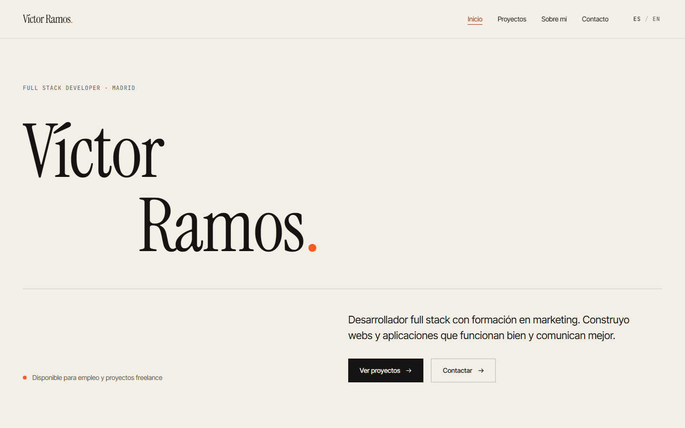
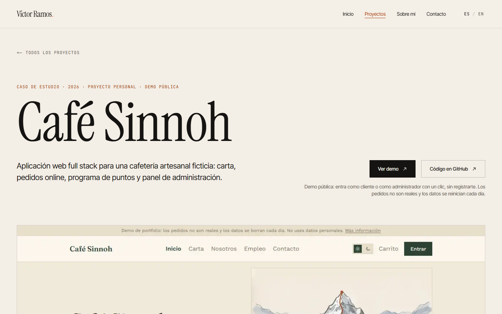

# Víctor Ramos — Portfolio

**Español** · [English](README.en.md)

Portfolio profesional y bilingüe (español e inglés) de Víctor Ramos, desarrollador full stack en Madrid. Diseño editorial propio, sin plantillas, construido con Next.js y casi sin dependencias.

**Web:** [victorramos.vercel.app](https://victorramos.vercel.app)

|                                    |                                                        |
| ---------------------------------- | ------------------------------------------------------ |
|  |  |

## Funcionalidades

- **Bilingüe con URLs traducidas:** `/es/proyectos` y `/en/projects`. El idioma se detecta en la primera visita, se recuerda y el selector lleva a la misma página en el otro idioma.
- **Proyectos con casos de estudio:** galería y página de detalle por proyecto (objetivo, reto, funcionalidades, decisiones técnicas, stack y galería), con URL compartible y una transición animada de la portada entre páginas.
- **Formulario de contacto real:** los mensajes llegan por email, con validación en el servidor, mensajes traducidos y protección antispam sin captcha.
- **Diseño adaptable** a móvil, tablet y escritorio, con menú móvil a pantalla completa.
- **Accesible:** navegación completa con teclado, foco visible, contraste AA y respeto a «reducir movimiento».
- **SEO técnico:** URLs canónicas, `hreflang`, sitemap, datos estructurados e imágenes para redes sociales generadas para cada página.

## Stack

|                    |                                                                     |
| ------------------ | ------------------------------------------------------------------- |
| Framework          | Next.js 16 (App Router, Cache Components, Server Actions), React 19 |
| Lenguaje y estilos | TypeScript, Tailwind CSS v4                                         |
| Email              | API de Resend (con `fetch`, sin SDK)                                |
| Calidad            | ESLint, Prettier, TypeScript estricto, Lighthouse                   |
| Publicación        | Vercel                                                              |

Dependencias de producción: solo `next`, `react` y `react-dom`.

## Decisiones técnicas destacadas

**Internacionalización sin librerías**

- Todas las páginas cuelgan de `app/[lang]`. Las carpetas usan nombres internos en inglés, y `proxy.ts` traduce las URLs públicas (`/es/proyectos` → `/es/projects`) y redirige la interna a la pública, para que cada página tenga una sola dirección.
- Los textos viven en diccionarios tipados: `en.ts` debe tener exactamente la forma de `es.ts`, así que una traducción que falte es un error de compilación.
- Los enlaces se generan siempre con una función `href()`, nunca a mano.

**Contenido separado del código**

- Perfil, proyectos, servicios y trayectoria están en `src/content` como datos tipados, con cada texto en los dos idiomas. Añadir un proyecto es crear una carpeta y registrarlo.
- Si la lista de slugs que usa el proxy y el registro de proyectos no coinciden, la build falla.

**Rendimiento**

- Toda la web se genera de forma estática al compilar; la única lógica de servidor es el formulario.
- Fuentes servidas desde el propio dominio con `next/font`; imágenes optimizadas con `next/image`; animaciones de entrada y de scroll solo con CSS.
- La transición entre la galería y el caso de estudio usa `<ViewTransition>` de React, sin librerías de animación.

**Errores y casos límite**

- Un proyecto inexistente devuelve un 404 real: el proxy lo detecta antes de renderizar (con Cache Components, la página empezaría a enviarse con código 200).
- Páginas de error y de «no encontrado» propias y traducidas.

**Formulario de contacto**

- Server Action que valida en el servidor y envía el mensaje con la API de Resend; la clave nunca llega al navegador.
- La acción devuelve códigos, no textos: el formulario los traduce, así la lógica no depende del idioma.
- Antispam con un campo trampa invisible y un tiempo mínimo de envío.

## Resultados de Lighthouse

Medidos sobre la build de producción:

|                           | Rendimiento | Accesibilidad | Buenas prácticas |
| ------------------------- | ----------- | ------------- | ---------------- |
| Escritorio                | 100         | 100           | 100              |
| Móvil (4G lento simulado) | 94–96       | 100           | 100              |

## Estructura

```
src/
  proxy.ts              Idioma, URLs traducidas y 404 de proyectos
  app/[lang]/           Páginas (Inicio, Proyectos, Sobre mí, Contacto, Privacidad)
  components/           layout/, home/, projects/, contact/, ui/
  content/              Perfil, proyectos, servicios y trayectoria (datos tipados)
  i18n/                 Idiomas, mapa de rutas y diccionarios
  lib/                  Metadatos, imágenes para compartir, utilidades
assets/fonts/           Fuentes TTF para generar imágenes (licencia OFL)
```

## Puesta en marcha

Requisitos: Node.js 20.9 o superior.

```bash
npm install
cp .env.example .env.local   # y añade tu clave de Resend (opcional: solo para el formulario)
npm run dev                  # http://localhost:3000
```

| Comando             | Qué hace                        |
| ------------------- | ------------------------------- |
| `npm run dev`       | Servidor de desarrollo          |
| `npm run build`     | Build de producción             |
| `npm run lint`      | ESLint                          |
| `npm run typecheck` | Comprobación de tipos           |
| `npm run format`    | Formatea el código con Prettier |

## Añadir un proyecto

1. Crea `src/content/projects/<slug>/` con sus imágenes y un `index.ts` (usa el de Café Sinnoh como plantilla: TypeScript avisa si falta algún campo).
2. Añádelo a `src/content/projects/index.ts` y su slug a `src/content/projects/slugs.ts`.

La galería, el caso de estudio, la URL, la imagen para compartir y el sitemap se generan solos.

## Autor

Desarrollado por [Víctor Ramos](https://victorramos.vercel.app), con [Claude Code](https://claude.com/claude-code) como asistente de programación. Yo he dirigido el proyecto: la idea, el diseño y las decisiones técnicas, y la revisión de cada parte antes de darla por terminada.

Contacto: [victorramos.devs@gmail.com](mailto:victorramos.devs@gmail.com) · [LinkedIn](https://www.linkedin.com/in/victor-ramos-berzosa-90651b238/) · [GitHub](https://github.com/Vicram4)

## Licencia

Sin licencia de código abierto: todos los derechos reservados. El código está publicado para que se pueda leer y evaluar, pero no se concede permiso para copiarlo, modificarlo ni redistribuirlo. Las fuentes de `assets/fonts` tienen su propia licencia (SIL Open Font License).
